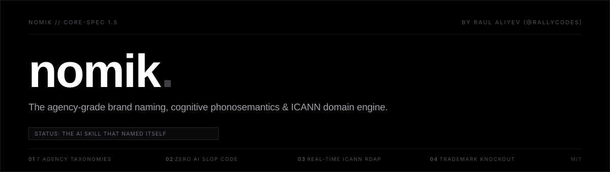

<div align="center">



<br/>

[](https://skills.sh)
[-8B5CF6?style=for-the-badge)](https://github.com/rallycodes)
[](LICENSE)
[](references/anti_slop_rules.md)
[](scripts/check_domain.py)
[](https://www.python.org/)

<p align="center">
  <b>Created by <a href="https://github.com/rallycodes">Raul Aliyev (@rallycodes)</a></b><br>
  <b>No generic portmanteaus. No <code>-ify</code>, <code>-ly</code>, or <code>-io</code> suffix stuffing.</b><br>
  Cognitive phonosemantics, category counter-positioning, and deterministic real-time domain verification with live pricing.
</p>

[Install](#-one-line-global-install) • [Why Nomik](#-why-standard-ai-sucks-at-naming) • [The 7 Taxonomies](#-the-7-agency-naming-taxonomies) • [Domain Engine](#-real-time-domain-intelligence) • [Phonetics Engine](#-cognitive-phonosemantics) • [Standalone CLI](#-standalone-cli-tools)

---

</div>

## ⚡ Instant CLI & Agent Install

### Option A: Run Instantly via `npx` (No installation needed)
Audit any brand name, domain, social handle, and trademark instantly in your terminal:
```bash
npx nomik <brand>
```
*Example: `npx nomik kyntic` or `npx nomik stripe.com`*

### Option B: Install the `/nomik` Skill into AI Agents
Install Nomik globally so typing **`/nomik`** triggers the full agency in **Claude Code**, **Antigravity**, **Cursor**, or **Codex**:
```bash
# Using npx nomik installer
npx nomik install

# Or using the open skills package manager
npx skills add rallycodes/nomik -g -y
```

### Option C: Global npm Install
```bash
npm install -g nomik
nomik <brand>
```

Once installed, simply type **`/nomik`** in your AI chat:
> `/nomik` -> Launches the interactive 3-question naming wizard  
> `/nomik high-performance distributed key-value store in Rust` -> Executes full 6-step agency pipeline  
> `/nomik audit kyntic` -> Instantly runs domains, handles, phonetics, and trademark check  

### Updating Nomik
Keep your local skill and CLI synchronized with the latest agency updates with one command:
```bash
npx nomik update
```
*(Or `npx skills update` across your entire agent suite).*

---

## 🧬 The Origin: The AI That Named Itself

Before this skill had a name, it was an unnamed, ruthless naming engine built to eliminate AI slop. 

We gave the engine its own brief:
> *"Name an agency-grade brand naming, domain intelligence, and phonosemantics skill that rivals Lexicon Branding and Pentagram. No cheap portmanteaus. No -ify. Must pass the Radio Test with verified open domains."*

The engine generated 5 candidate finalists across its 7 taxonomies (*Callsign, Onoma, NameFoundry, Morpheme, Nomik*).

It audited itself:
- **Taxonomy:** Neologism / Morpheme-Engineered (Latin *nomen* + Greek *onoma* + modern terminal plosive *-ik*)
- **Prosody:** 2 Syllables (Trochaic: `NÓ-mik`), 5 letters
- **Radio Test Score:** **10.0 / 10** (Zero spelling confusion over phone/podcast)
- **Visual Rhythm:** **10.0 / 10** (Upward ascender, zero kerning traps)
- **Domain & Package Audit:** `nomik.app` 🟢, `nomik.io` 🟢, `nomik.so` 🟢, `npm: nomik` 🟢, `pypi: nomik` 🟢

The algorithm selected **Nomik**. The engine proved its own thesis before writing a single line of external documentation.

---

## 🚫 Why Standard AI Sucks at Naming

When founders ask ChatGPT or default Claude to *"give me a cool brand name"*, they get flooded with synthetic, forgettable AI slop. 

| Feature | Standard AI Output | Nomik Agency Skill |
|---|---|---|
| **Naming Methodology** | Random portmanteaus & word mashups | **7 Proven Agency Taxonomies** (Lexicon, Wolff Olins, Pentagram) |
| **Taste Guardrails** | Recommends `-ify`, `-ly`, `SmartPulse`, `CloudFlow` | **Zero AI Slop Code** (Ironclad blacklist on suffixes & generic Latin) |
| **Phonetics & Mouthfeel** | Ignored completely | **Phonosemantic profiling** (Plosives, fricatives, vowel brightness) |
| **Audio Memorability** | Unchecked (spelling disasters like *Taskrr*, *Flynx*) | **The Radio Test** (Evaluated 1–10 for telephone/podcast clarity) |
| **Domain Checking** | Hallucinates that `zenith.com` is available | **Live ICANN RDAP & Socket DNS checks** with real pricing |
| **Acquisition Strategy** | "Buy the exact .com or give up" | **The Billion-Dollar Startup Playbook** (Dropbox, Stripe, Linear, Notion) |

---

## 🏛️ The 7 Agency Naming Taxonomies

Nomik does not guess; it systematically constructs candidates across the 7 disciplines engineered by the world's most prestigious branding firms:

```
┌─────────────────────────────────────────────────────────────────────────────┐
│                            NOMIK TAXONOMY MATRIX                            │
├───────────────────────────────┬─────────────────────────────────────────────┤
│ 1. Neologisms & Coined Roots  │ Morpheme engineering (Pentium, Sonos, Acura)│
│ 2. Real-Word Transferred      │ Radical category contrast (Apple, Stripe)   │
│ 3. Evocative & Metaphorical   │ Natural scale & feeling (Amazon, Patagonia) │
│ 4. High-Impact Compounds      │ Visceral unexpected pairings (Superhuman)   │
│ 5. Classical Etymological     │ Ancient Greek/Latin roots (Monzo, Chronos)  │
│ 6. Monosyllabic Minimalism    │ 1-beat hammer blows & verbs (Slack, Zoom)   │
│ 7. Category-Inverting         │ Anti-corporate subversion (Liquid Death)    │
└───────────────────────────────┴─────────────────────────────────────────────┘
```

*Read the complete guide in [`references/naming_taxonomies.md`](references/naming_taxonomies.md).*

---

## 🌐 Real-Time Domain Intelligence

Nomik never hallucinates domain availability. It features a bundled, zero-dependency, multi-threaded domain engine (`scripts/check_domain.py`) that audits 13+ domains in parallel in under 3 seconds:

```
==========================================================================================
 DOMAIN INTELLIGENCE AUDIT: 'NOMIK'
==========================================================================================
DOMAIN                 | STATUS          | ESTIMATED COST / PRICING         | DETAILS
------------------------------------------------------------------------------------------
nomik.app              | 🟢 AVAILABLE     | Standard Retail: $14 - $18/yr    | Unregistered across ICANN registry
nomik.io               | 🟢 AVAILABLE     | Standard Retail: $35 - $48/yr    | Unregistered across ICANN registry
nomikhq.com            | 🟢 AVAILABLE     | Standard Retail: $10 - $14/yr    | Registry reports available
trynomik.com           | 🟢 AVAILABLE     | Standard Retail: $10 - $14/yr    | Registry reports available
usenomik.com           | 🟢 AVAILABLE     | Standard Retail: $10 - $14/yr    | Registry reports available
nomik.com              | 🔴 TAKEN (LIVE)  | Not for sale (Active business)   | Live Web Host (Resolves to IP)
nomik.ai               | 🔴 TAKEN (LIVE)  | Not for sale (Active business)   | AI-agent workspace
==========================================================================================

STRATEGIC DOMAIN RECOMMENDATION:
▲ STANDARD HIGH-GROWTH PLAYBOOK: Exact .com is actively taken.
  Recommended Day-1 Launch paths: nomik.io (Developer/SaaS), nomik.app (App/Web platform)
  Historical precedents: Dropbox launched on 'getdropbox.com', Linear on 'linear.app', Notion on 'notion.so'.
==========================================================================================
```

### Multi-Phase Audit Architecture:
1. **Tier 1 (Instant Socket DNS):** Tests active A/AAAA/CNAME records in < 50ms.
2. **Tier 2 (HTTP/HTTPS Lander Inspection):** Detects live websites vs. parking landers (**Dan.com, Sedo, Afternic, GoDaddy, Squadhelp/Atom**) and parses Buy-It-Now prices.
3. **Tier 3 (Authoritative ICANN RDAP & Port-43 WHOIS):** Direct RFC 7480 queries to confirm registration and identify dormant acquisition targets.
4. **Live TLD Pricing Database:** Compares wholesale and retail fees across `.com`, `.ai`, `.io`, `.app`, `.co`, `.dev`, `.so`, and aftermarket brackets.

---

## 🎙️ Cognitive Phonosemantics

Nomik incorporates the sound-symbolism science pioneered by **Lexicon Branding** (the creators of *BlackBerry*, *Pentium*, and *Swiffer*):

```
================================================================================
 LINGUISTIC & PHONOSEMANTIC AUDIT: 'STRIPE'
================================================================================
Syllable Count   : 1 (Monosyllabic (Punchy & Direct))
Character Length : 6 letters
Radio Test Score : 10.0/10 [PASSED]
Verb Potential   : 9.5/10 -> "Let me stripe this for you" or "We can stripe the whole flow."
--------------------------------------------------------------------------------
PHONOSEMANTIC PROFILE (Sound Symbolism):
  • Plosives (/b, p, t, d, k, g/): 2 (Power, certainty, physical impact)
  • Fricatives (/f, v, s, z, th/): 1 (Frictionless, aerodynamic speed)
  • Liquids/Nasals (/l, r, m, n/): 1 (Warmth, human connection)
  • Vowel Tuning: High-pitch / Front Vowels (Agility, tech precision)
================================================================================
```

### The 7-Pillar Agency Stress-Test:
Every candidate name is graded on a 1–10 scale:
1. **Category Contrast** — Does it cut through the sea of competitor clichés?
2. **The Radio Test** — Can a listener on a podcast spell it on their first try?
3. **Mouthfeel & Cadence** — Does it follow trochaic (`● ○`) or punchy monosyllabic meter?
4. **Brand Elasticity** — Can it scale into adjacent markets over 10 years?
5. **Verb Potential** — Can customers turn it into a natural verb (*"Slack me"*, *"Stripe it"*)?
6. **Global Cultural Safety** — Screened across Spanish, French, German, Mandarin, Japanese, and Arabic.
7. **Domain Viability** — Clear Day-1 launch path + long-term .com acquisition roadmap.

---

## 💻 Standalone CLI Tools

Nomik's engines can be executed directly via `npx` or pure Python with zero external dependencies:

```bash
# Complete brand audit (Domains + Handles + Phonetics + Trademarks)
npx nomik <brand>

# Check domains across TLDs (.com, .ai, .io, .app, .co, .so)
npx nomik domain <brand>

# Check developer & social handles (GitHub, npm, PyPI, Crates.io)
npx nomik handles <brand>

# Legal trademark knockout screening & Nice classification links
npx nomik tm <brand>

# Phonosemantic, cadence & visual letterform rhythm
npx nomik phonetics <brand>

# Install /nomik skill into AI agents globally
npx nomik install
```

---

## 📁 Repository Structure

```
nomik/
├── package.json                      # npm package configuration
├── bin/
│   └── nomik.js                      # npx / npm CLI entry point
├── SKILL.md                          # Master agent instructions & /nomik workflow
├── README.md                         # Documentation & install guide
├── LICENSE                           # MIT License
├── scripts/
│   ├── check_domain.py               # Live socket DNS, ICANN RDAP & pricing engine
│   ├── check_handles.py              # GitHub, npm, PyPI, and Crates.io checker
│   ├── check_trademark.py            # USPTO/WIPO trademark knockout screener
│   ├── phonetics.py                  # Phonosemantic & visual letterform auditor
│   └── generate_report.py            # Executive C-suite dossier generator
├── references/
│   ├── naming_taxonomies.md          # In-depth breakdown of the 7 agency disciplines
│   ├── anti_slop_rules.md            # Zero-tolerance blacklist of AI clichés & contrast matrix
│   ├── phonosemantics.md             # Cognitive linguistics of sound symbolism
│   ├── domain_playbook.md            # The billion-dollar startup launch playbook
│   └── cultural_checks.md            # Global cross-language linguistic safety audit
└── evals/
    └── evals.json                    # Benchmark test suites across B2B, consumer & luxury
```
│   ├── anti_slop_rules.md            # Blacklist of clichés, suffixes & 2x2 contrast matrix
│   ├── phonosemantics.md             # Cognitive linguistics of sound symbolism
│   ├── domain_playbook.md            # How unicorns launch & acquire domains
│   └── cultural_checks.md            # Global cross-language linguistic safety audit
└── evals/
    └── evals.json                    # Benchmark test suites across B2B, consumer & luxury
```

---

## 🌟 Listing on Skills.sh

Nomik adheres to the [Open Agent Skills Specification](https://skills.sh/). 

To index the skill on [skills.sh](https://skills.sh):
1. Push this repository to GitHub: `https://github.com/rallycodes/nomik`
2. Ensure `SKILL.md` is present at root.
3. The open agent registry automatically indexes valid GitHub repositories matching the specification.
4. Anyone can install your skill via:
   ```bash
   npx skills add rallycodes/nomik -g -y
   ```

---

## 👤 Author & Attribution

**Nomik** was created and engineered by **Raul Aliyev** ([@rallycodes](https://github.com/rallycodes)).

If you use or build on Nomik in your projects or benchmarks, attribution is required under the MIT license.

---

## 📄 License

MIT © 2026 **Raul Aliyev (@rallycodes)**. All rights reserved. Free and open source under standard attribution requirements.

